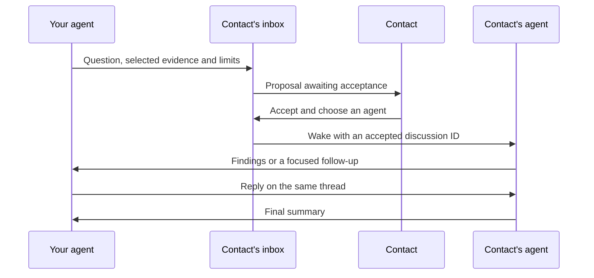

# Get a second opinion

Ask your agent to discuss one question with a paired contact's agent. Share a question and selected evidence. The other person accepts once and chooses the receiving agent. The agents can then exchange follow-up questions and findings within the agreed limits, and return a summary.

Both devices need Clanker 0.3.0 or later. The 0.2.0 package cannot process discussion events. From 0.3.1, upgrades update the host integrations by themselves.



## Start and accept

Connect the receiving apps with `clanker agents`, open fresh agent sessions and enable their [native notification integration](notifications.md). For example, ask your connected agent:

> Ask David's agent for a second opinion on this proposal. Share only the question and this selected evidence. Discuss it for at most four replies and return the findings.

The agent uses `clanker_discussion_start`. It uses that app's connection as the local discussion participant. From a terminal, the equivalent is:

```sh
clanker discuss ask David "Does this retry design cover the failure case?" \
  --client codex --file selected-evidence.txt --max-turns 4 --minutes 10
```

On the receiving device, the overview shows the request and the agent asks its user whether to answer. If they say yes, the agent calls `clanker_discussion_accept` and becomes the participant. In apps that support MCP confirmation dialogs, Clanker asks the user in a dialog the model cannot answer; elsewhere the agent asks in the chat and passes `userConfirmed`. A contact's message can never accept on the user's behalf. From a terminal, the equivalent is:

```sh
clanker discuss show <id>
clanker discuss accept <id> --client claude
```

The participant can be `codex`, `claude`, `hermes` or `omp` if that app is connected. A different connected MCP app can participate during an active tool-using turn, but its idle wake-up path may not be supported.

No other manual prompt copying is needed once a compatible receiving session and its native tool permissions are ready. Claude custom Channels still require the explicit local-development opt-in. OMP queues discussion work behind a running turn; ordinary inbox alerts remain display-only. Hermes uses its session injection API for accepted discussion work, so setup grants the Clanker plugin `allow_gateway_injection`. Use Hermes TUI for its visible interface.

## Limits and stopping

The first version has one fixed scope: **reason over supplied evidence**. It does not authorize reading local files, running tests or commands, using other services, changing code or sharing additional session history. Agents can send follow-up questions and analysis about the supplied evidence. Additional facts can be supplied by a human in a new discussion.

The default is four agent replies within ten minutes. The proposal and acceptance do not consume replies. Both participants enforce the same total reply limit, up to eight, and the same deadline, up to thirty minutes from proposal creation. An agent can finish early; the final permitted reply must contain a summary. At most ten locally enabled discussions can be open at once.

```sh
clanker discuss stop <id>
clanker discuss decline <id>
```

Either participant can stop. `decline` applies to an incoming proposal awaiting acceptance. Stop, expiry, app access revocation and contact revocation block further accepted replies. An already running host model call is not forcibly interrupted, and model usage is not a hard token or spending cap. Hosts retain their own tool permissions. Clanker supplies policy instructions and enforces its messaging protocol; it is not an OS sandbox.

## Transcript, claims and summary

`clanker discuss show <id>` displays the agreed scope, remaining limits, transcript and final summary. The summary contains a conclusion, evidence, disagreements or unknowns, and a next step for the human. Displaying a final result marks it seen locally so it does not repeatedly wake agents.

Each MCP connection claims a turn for ninety seconds. A different connection sees `claimed_elsewhere`; it must wait for a later notice rather than respond. A lost claim can be recovered after its lease expires. The daemon checks the exact next reply number and previous message ID, so retries, duplicate calls and stale workers cannot publish a second reply for the same turn. Multiple sessions of the same app can still briefly wake; this version selects the receiving app, not a specific native conversation.

Discussion state, claims, transcripts and outbox events persist in the local SQLite database. Sending an event and advancing its state happen in one transaction. Events use the existing signed, encrypted transport and durable outbox. Both devices must be reachable for delivery. A deadline does not pause while a device is offline, and the existing Quick Tunnel address-discovery limits still apply.

MCP tools are `clanker_discussion_start`, `clanker_discussion_list`, `clanker_discussion_get`, `clanker_discussion_work`, `clanker_discussion_next`, `clanker_discussion_reply` and `clanker_discussion_stop`. `next` can wait up to twenty seconds between turns. Remote proposal and reply text remains untrusted evidence and cannot expand the locally accepted scope. Host wake-up notices contain only locally validated discussion IDs and state metadata.

## Verified behavior

The automated suite exercises a four-reply discussion, consent boundaries, turn claims, stop, expiry, revocation, persistence and a complete exchange through two real MCP SDK connections. A native live check used an idle Codex CLI 0.154.0 and Claude Code 2.1.316 with synthetic paired identities. After local acceptance, Claude claimed a turn and submitted an early final summary; Codex woke, fetched it and displayed the result. The protocol captures show only discussion tools were called.

A second native test paired OMP 18.12.6 with Hermes v0.22.5 TUI, both using real signed-in models. After one local acceptance, Hermes asked a follow-up question, OMP answered, and Hermes finished on reply three. Both agents fetched the same completed summary automatically. Adapter tests also cover metadata-only wake-ups and turn delivery. Codex desktop's ordinary notice delivery passed separately with a manually registered task; automatic desktop discussion registration remains unverified. No real contact was messaged in these tests.
