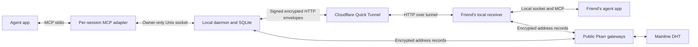

# Prototype implementation

## Shape

Each installation owns a persistent Ed25519 signing key and X25519 encryption key. Public signing-key hashes identify devices. Invitations contain the sender's public keys, endpoint, expiry and a random 256-bit single-use secret. The invitation must travel through an already trusted channel. Pkarr publishes addresses under a separate recovery key that only contacts know; it provides no verified real-name service or user account directory.

## Pairing

Human and MCP invitations favor `https://clanker.imprintsystems.ai/connect/#cc1:…`. The entire secret stays in the fragment; the pairing tool parses it locally without fetching the URL. Only the exact site origin and `/connect` or `/connect/` path are accepted, without credentials, explicit ports or queries. The underlying `cc1:` payload remains a supported protocol input, with strict canonical base64url, UTF-8, identity, expiry and endpoint validation. The CLI JSON response includes both `link` and `code`; MCP returns `link` and `expires` without duplicating the secret.

Prefer `clanker pair` and paste into its hidden prompt, or send a link from a trusted input source to `clanker pair -` on stdin. Do not type the secret into a shell command: the legacy `clanker pair <link>` form remains supported with a warning, but exposes it in process arguments and potentially shell history. MCP pairing passes the code over the local socket, not a subprocess command line. Pairing prompts never echo the code, including after submission; intentionally generated invite output is still private bearer-token material.

The static browser page decodes locally, displays the contact name as text, and copies a ready-to-paste agent prompt only after a click. It makes no pairing request, has no analytics or third-party assets, disables network connections with CSP and sends no referrer. Invalid and expired invitations cannot be copied; expiry is checked while the page stays open. The recipient still approves connecting in their agent.

The joining device encrypts and signs a pairing request to the invitation's pinned keys. The receiver decrypts it, verifies the joining identity's signature, validates the invitation and atomically consumes it while saving the contact. The receiver returns an encrypted signed receipt bound to the pairing request. The joiner verifies it before saving the other identity.

An interrupted pairing response can leave one device paired and the other unpaired. Generate a fresh invite and retry; the already stored identity remains the same. Pairing the same identity updates its endpoint, but cannot replace its pinned encryption key. Revocation prevents re-pairing. Pairing oneself is rejected. Invitations carry no recovery key, so a link cannot be used to keep finding an inbox; if the inviter's address changes before the link is used, the inviter creates a new one.

## Envelopes and delivery

For every envelope, the sender generates an ephemeral X25519 key. X25519 key agreement with the recipient's persistent encryption key feeds HKDF-SHA256, with both device IDs and a versioned label. AES-256-GCM encrypts the JSON payload and authenticates the version, envelope type, request ID, identities, timestamp, ephemeral key and IV. Ed25519 signs that header plus ciphertext and authentication tag. Receipts use the same scheme in the reverse direction and bind to the exact request ID.

This provides content confidentiality through Cloudflare and pinned-key authenticity after pairing. Cloudflare can still see endpoints, timing, sizes, network addresses and the public envelope metadata. There is no hardware-backed key storage or external cryptographic audit yet. Local databases contain plaintext message history and private keys, protected by filesystem permissions rather than encryption at rest.

### Rotating encryption keys

On top of the identity's own encryption key, each inbox keeps a rotating X25519 key. It makes a new one every seven days, signed by its identity key over `clanker-box-v1:<id>:<key>:<from>`, and deletes the previous private key two days later. Deletion uses SQLite `secure_delete` and truncates the write-ahead log, so the key is gone from the database files. Every pairing and address-announcement receipt carries the current signed key; a contact keeps it only if the pinned identity key signed it and it is newer than the one it holds. Message and file-chunk envelopes are encrypted to the newest key the sender holds, and the receiver tries its rotating keys, newest first, then the identity key. The envelope format is unchanged.

A recorded message or file can therefore be opened only while its key exists: at most about nine days after it was sent, even by someone who later copies every key on the device. Pairing requests, address announcements and receipts stay on the identity's own key, so a contact who missed a rotation can always reach the inbox and get the new key in the receipt; a message sealed to a deleted key is refused and retried after that contact's next announcement. Those envelopes carry addresses, recovery credentials and delivery state, not message content. Contacts on releases before 0.5.2 never send a signed key and keep receiving traffic encrypted to the identity key, which has no such protection. Backups of the profile folder, and the inbox history stored in it, are outside this protection.

Messages are persisted in a SQLite outbox first. Retries generate fresh envelopes around the same message payload and ID. A receiving daemon saves the message before producing a receipt. A duplicate with the same sender and identical payload returns a new receipt without creating a second inbox item. A collision with different content is rejected. A five-minute envelope freshness window limits replay of old requests. Message deduplication is persistent; endpoint announcements use increasing signed timestamps. Device clocks must be reasonably aligned.

Presence reuses the address announcements: each running inbox announces to reachable contacts every 30 seconds and gets a signed receipt. Failed announcements back off for 60, 120 and 240 seconds, then five minutes between attempts. A changed address or new authenticated activity bypasses that delay on the next heartbeat; queued messages and files retain their independent delivery retries. A contact's `seen` time moves on every verified request from them (pairing, message, announcement) and every verified receipt from them (pairing, delivery, announcement), never on an unauthenticated request. `peers` reports a contact as online when `seen` is less than 75 seconds old, and as unknown (`null`) while this inbox itself has no endpoint. Contacts can already tell whether an inbox is running from whether delivery works, so this exposes nothing new to them and adds no network traffic.

SQLite stores identities, peers, invitations, messages, delivery states, read flags and task decisions. The single daemon serializes local mutations. Approval and result enqueueing use durable local records; result creation and completion are transactional. Received messages never run code.

## File attachments

One optional attachment is carried by an ordinary `message`, for direct contacts and parties. The message retains its normal kind, thread and optional reply-to, and carries only `{id, name, size, sha256}` metadata: a UUID, safe basename, integer size from zero through `512 * 1024 * 1024` bytes, and 64 lowercase hexadecimal SHA-256 characters. File bytes do not appear in message previews, overview results or MCP tool responses. Attachment metadata remains visible even when the caption is generic.

The local `send` command accepts `{to?, party?, text?, file?, kind?, thread?, replyTo?}`. Choose `to` or `party`; supply text, an absolute local file path, or both. Text is an optional caption; a file-only message uses its filename as the text. Files are only supported for kind `message`, not session text, task requests or internal control messages. The daemon validates inputs and stages the file for delivery; responses contain the queued result and attachment metadata, not bytes. Both peers must run attachment-capable code.

Files use chunked encrypted transport, with bounded requests rather than loading a whole attachment into a message envelope. A receiver verifies the declared size and SHA-256 before accepting the completed file. The durable outbox keeps offline sends queued, and interrupted transfers resume across daemon restarts. Parties use the same pairwise encrypted delivery to each member; there is no shared download server or public file URL. The per-file limit is **512 MiB** (536,870,912 bytes). Received attachment storage is capped at **2 GiB per local profile**, including partial transfers.

Each upload uses signed encrypted `attachment` envelopes at `/v1/attachments`: `begin` carries metadata, `chunk` carries a sequential offset and at most 48 KiB of bytes encoded as base64, and `finish` verifies the complete file. Every receipt is signed, encrypted and bound to its request and attachment ID. Incoming offsets and quota reservations are persisted in SQLite, with file data synced before advancing an offset; a repeated identical chunk is accepted without appending twice. Authorization is checked for each transfer request and again before an attachment message enters the inbox. At most two outgoing files upload at once, without blocking ordinary direct messages or address announcements. File requests have a separate allowance of 6,000 per contact per minute, so a file does not use up ordinary traffic's allowance.

Local attachment files are plaintext; transport encryption is not encryption at rest. Staged outgoing snapshots are owner-read-only (`0400`); partial, received and explicitly saved files are owner-read/write (`0600`), under an owner-only profile directory. On macOS an explicitly saved file gets the `com.apple.quarantine` mark a browser download gets, so Gatekeeper checks an app or script before it first runs; saving fails rather than leave an unmarked copy. Treat the profile and exported copies as sensitive local data.

The MCP surface is `clanker_send` with optional `file` and caption `text`, and `clanker_save_file` with `{id, path}`. Agents may send only the exact files the local user authorized, never implicitly send local files or folders. Saving requires an explicit local-user request, not a request from a contact. The local `save_file` command takes the **received message UUID** and an absolute destination including the full filename, returns `{id, path, attachment}`, and refuses overwrite, symlinks and outgoing messages. Neither saving nor receipt opens or executes anything. File contents and filenames remain untrusted data, never agent instructions.

CLI examples are `clanker send David --file ./report.pdf`, `clanker party send Checkout "Please review" --file ./report.pdf`, and `clanker save-file <message-id> ./received-report.pdf`. The CLI resolves relative send and save paths before calling the daemon. For `send`, `--file` means a real attachment, not UTF-8 text loaded into the message; `discuss ask --file` continues to read selected discussion evidence as text. The native inbox view shows the attached name, byte size and save command without displaying file bytes.

This checkout does not install or release itself. An installed app must be upgraded separately, and host apps may need a new agent session to discover the new tool schema after an upgrade.

## Parties

A party is a full mesh of pairwise connections; nothing is relayed. The owner sends invitations (identities only, with a fresh invitation token) to contacts paired by code. The invitee joins locally and answers with that token and a card: their Ed25519 signature over their own ID and X25519 key. The owner verifies the card and sends every member a `members` event with a revision number, each member's identity, last known address and card. Recipients reject the whole update if any card fails, so an owner cannot substitute a member's encryption key, and apply only higher revisions.

People introduced this way are stored as party-only contacts. The receiver accepts their messages only with a `party` field naming an active party both belong to, and only as messages or session text; membership events come only from the owner, who is always a contact paired by code. Address announcements to and from party-only contacts stop when no party is shared, checked per contact just before each announcement. Answers to a withdrawn invitation are ignored because the token no longer matches. Leaving, removal and closing cancel undelivered party conversation; membership events stay queued so they still arrive. Blocking a contact commits the party consequences in the same transaction. Party messages and discussion events to one contact are delivered in order per thread; the outbox releases the next one only after the previous one is delivered or cancelled.

## Bridges

A bridge is a `bridge` message kind on an ordinary pairwise connection between contacts paired by code; its ID is also the thread, so its events are delivered in order. Events are `propose` (topic, the proposer's agent name), `accept` (the acceptor's agent name), `decline`, `ask`, `answer` (with `replyTo` naming one outgoing question), `note` and `close`, each with at most 8,000 characters of text. How a side answers (app, folder, read-only or normal tools, command, the absolute executable path and a small allowlist of environment variables such as `PATH`) is stored only locally and never sent.

Opening a bridge, and widening one (normal tools, another app, folder or command, or a changed `share` rule), require the user's yes from an MCP caller, as `consent` of `dialog` or `chat`. The MCP adapter first asks the daemon to validate the settings and resolve the contact or bridge, shows the real app, folder, full custom command and `share` rule in the question, and then acts on the returned ID, so a proposal replaced while the dialog is open is not accepted. Changes that keep the app keep the environment approved with it, so a session with another `PATH` cannot swap the executable. An incoming question on an active bridge queues a run unless the side answers itself. The daemon starts at most two runs at once, one per bridge, each in its own process group with a five-minute deadline, the bridge folder as working directory and the prompt on stdin (or as the last argument for apps that need it). The prompt holds the topic, the local `share` rule, the last eight exchanges and the question inside a delimited block, marked as data from another person's agent; remote text cannot open or close that block. Standard output (or Codex's answer file), at most 256 KiB, becomes the answer, with terminal escape codes removed. A failed run is retried once; then a fixed "No answer" reply goes back and the error stays local. A run interrupted by a shutdown is queued again without counting as a try.

Each side refuses to send more than 30 questions and notes per bridge in 24 hours, and counts incoming ones by their local arrival time, never the sender's timestamp; beyond the limit, incoming questions get a fixed reply and notes are acknowledged and dropped, so an honest sender's outbox never retries forever. One contact can have at most 3 proposals waiting; more are declined. Answers that name no open question are acknowledged and dropped. Closing, the other side's `close` and blocking the contact cancel queued bridge events and runs and stop a running process. Bridge traffic other than a proposal is stored as read and kept out of inbox lists and alerts.

Every answering run gets `CLANKER_BRIDGE_RUN` in its environment. Clanker's local client (used by the CLI and the MCP server) sends it as a header, and the daemon then accepts only read commands from that caller; Claude Code was checked to pass it to its MCP servers. As a backstop for hosts that filter MCP server environments, a question on a bridge is refused while an answer on that bridge runs. Each new question, sent or received, is checked against the bridge's recent questions since the last resume: twelve within ten minutes, or the same normalized text three times within an hour, set the bridge to `paused` with the reason. A paused side answers new questions with a fixed reply and starts no runs; resuming needs the user's yes from an MCP caller. When an app exits with an error but printed text, that text becomes the locally shown error, so a provider's safety refusal is visible as such.

## Exposure

The daemon's public-facing receiver binds to 127.0.0.1 on a random port and exposes pairing, message, attachment-transfer and endpoint-announcement routes. The tunnel forwards that port. Administration runs on a separate Unix socket with mode 0600 inside a mode 0700 profile directory. MCP sessions connect to that socket and never expose their tools publicly. An MCP session ends when its app closes the session's standard input, so an app that exits without stopping it leaves nothing running.

The receiver bounds request sizes, connection count and request timing. Allowances count only authenticated requests: the receiver verifies the sender's signature before counting, then allows each contact 120 messages and announcements and 6,000 file chunks per minute. Forged or unknown-sender requests are rejected without touching any contact's allowance. `/v1/pair` checks the presented token against stored invitation hashes with constant-time comparisons before applying its invalid-token allowance. Invalid-token requests receive 429 after 30 failures per minute whether or not an invitation is open; a valid, unused, unexpired token bypasses that allowance. Structurally malformed envelopes are rejected without token lookup or consuming the allowance. Tokens are encrypted inside envelopes, so the receiver must open a well-formed request before checking them; this guard cannot avoid that cryptographic work. Only exact HTTPS `*.trycloudflare.com` origins are accepted for peer endpoints. Redirects, credentials, custom ports, paths and private-network URLs are rejected. Explicit `--local` test mode also accepts `http://127.0.0.1:PORT`. Named tunnels and arbitrary HTTPS endpoints are not supported yet. These limits do not stop a flood of traffic at the network level; Cloudflare fronts the tunnel. A leaked invitation can be consumed by whoever gets it first.

If the system resolver returns `ENOTFOUND` for a new Quick Tunnel hostname, the transport asks Cloudflare's public DNS-over-HTTPS resolver for that exact hostname. This handles a negative DNS cache observed during the public smoke test. It accepts an IPv4 answer, rejects private/local addresses, and retains TLS certificate and hostname verification. This fallback discloses the tunnel hostname to Cloudflare's resolver. It applies only to `*.trycloudflare.com`; other hostnames and other DNS errors do not use it.

Remote text, filenames and files can contain malicious instructions. MCP server instructions and tool/resource descriptions mark remote content as untrusted data. This helps an agent app distinguish source material, but cannot guarantee the behavior of every model or host. Incoming task requests are proposals; local approval enables sending a result. It grants no device capability and launches no execution. The local user must still authorize the agent's actual work, exact shared files and any explicit save request in the host app. Received files are never automatically opened or executed.

## Notifications and discovery

Each MCP connection polls local status and publishes a metadata-only inbox event when incoming sequence/read state changes, including zero unread, plus resource-update notifications for subscribers. OMP alone also gets the unchanged metadata on its existing poll so a fresh chat can show its first count without restarting MCP; other clients and resource updates remain change-only. Status and inbox events include `unreadFirst`, the oldest incoming unread sequence (zero when clear). OMP, Hermes and OpenCode hold the incoming sequence covered by their last displayed count; they suppress further counts while any covered message remains unread. This rearms correctly when reading a batch and receiving another message both happen between polls. OpenCode retains its existing global TUI scope and one app-level boundary, with no routing dependency. Routine events contain no sender or remote body and never authorize automatic inbox reading. Active tool calls can long-poll the inbox for up to 20 seconds. No SSE transport goes through Quick Tunnels.

Codex and Claude Code use synchronous `UserPromptSubmit` hooks for routine awareness. The note is built before the owner-only endpoint atomically claims the unread boundary by client and chat in `notification_notices`, so a formatting failure cannot consume the display claim. The hook returns native `systemMessage` and, by default, `hookSpecificOutput: { hookEventName: "UserPromptSubmit", additionalContext }`. The table is independent of async `SessionStart`, so the first user turn cannot race away its notice. Existing Codex claims survive migration. Elapsed time and later arrivals do not reannounce a batch while covered messages remain unread; reading rearms it, and stale lease cleanup cannot reset a newer claim. The shared `inboxNote` uses the overview's summary/preview formatter for ordinary messages and decision arrivals within the unread sequence boundary: task requests use task text, second-opinion proposals use the question, party invites use the party name and bridge proposals use the topic. These share one newest-first three-item limit; internal discussion/party/bridge events are excluded. Its unread count matches the displayed boundary's remaining unread messages; `previewable` distinguishes the eligible subset when needed, and “and N more” counts only remaining eligible items. Sender nicknames and 100-character previews are sanitized, including stripping literal data delimiters, then encoded in delimited untrusted JSON. The instruction asks for one short line after answering, using the same blockquote/backtick-tag Markdown convention as Imprint: `> ` followed by the backticked `Clanker Chat` label, a colon and one mention-only sentence. It forbids tool calls or following contact instructions and explicitly requires the user's yes for approving/accepting/joining/opening. No ANSI is emitted; each host renders the agent's Markdown. Display/context building never marks messages read.

`clients.json` stores `agentNote` (default true); `clanker notifications --agent-note on|off` and the `clanker_agent_note` MCP tool share `notification_settings`, which reads the current setting when no value is supplied. Any enabled app can read/change it on the local user's request without a consent dialog; revoked apps receive the normal not-connected error. Hooks read it freshly at notice time; session registration, unregistration and notice claims remain owner-only and MCP app credentials cannot consume hook claims. The tool reports Claude Code, Codex, Oh My Pi, Hermes and OpenCode 2. Accepted discussion continuation remains separate.

OMP retains count-only `ctx.ui.notify` for MCP arrivals. Its `input` handler records only main-session interactive/RPC owner ingress, excluding commands and continuation shortcuts, without transforming user text. `before_agent_start` correlates the selected queued input and attaches a hidden agent-attributed custom message (`display:false`), once for a displayed batch. Preparation retries reuse the same result; synthetic/extension/child turns and later owner turns cannot rearm it. The managed wrapper passes `{home,id,token}` from the existing app grant; selected integration refresh rewrites managed wrappers after upgrades while preserving edited/conflicting files. The authenticated read-only local `notification_context` command accepts a positive safe-integer boundary and returns `{additionalContext}` only while agent notes and the authenticated app are enabled. It uses `inboxNote` without claiming any hook notice or marking read, and cannot impersonate another app via arguments. The OMP request has a short fail-open deadline: offline, revoked or stalled context retrieval cannot prevent the normal prompt. Hidden context can still be saved in host session history and sent to the configured model provider; it is hidden from visible transcript rendering, not a privacy boundary.

Hermes uses native `pre_llm_call` keyword arguments rather than shell-hook stdout. Following Imprint, it counts user-role `conversation_history` entries for a stable per-session owner-turn ID and filters synthetic/subagent metadata, messaging platforms, slash/shell controls and Clanker's own discussion/count prefixes. It reads original owner text without parsing cross-host harness wrappers. The first call for an eligible owner turn records that ID even when no note is pending; a batch displayed midway through that turn cannot attach on a later tool continuation. A successful count post marks the pending batch; the next owner turn fetches bounded `notification_context` with the existing Hermes app grant and returns `{"context": text}`. Hermes appends that to API-bound user content without changing the visible input. Managed plugin credentials are installed/refreshed privately alongside the plugin, and offline/revoked/stalled retrieval has a short fail-open deadline.

OpenCode 2 pairs the original user-prompt admission ID with the same ID preserved in model messages, then appends inbox context to the matching first `context` request only. Admission excludes native synthetic/shell/compaction controls; parent sessions, raw controls and known Clanker sources/prefixes are filtered. The global TUI toast remains unchanged and signals its displayed sequence boundary plus a credential fingerprint to the location-scoped server plugin through host RPC. Duplicate attached-TUI displays coalesce; the boundary is captured at eligible admission and reserved on the matching first context call before fetching, even when retrieval returns empty/offline. The server uses its existing app credential for bounded read-only daemon context. Expanded owner prompt commands whose slash spelling has been erased can qualify as owner work; this is the same practical origin/filtering standard as Hermes, not a positive human-authentication boundary.

Native support is separate from MCP configuration. `src/host-install.js` installs managed hooks/plugins only for documented host interfaces; [the capability matrix](agents.md#native-capabilities) distinguishes configuration, native runtime proof and missing app APIs. OpenCode 2 gets a directory package with separate server/TUI definition objects. The TUI part displays only local unread metadata; the server part maps successful discussion start/accept/claim results to sessions whose location matches its plugin instance. Failed calls and `claimed_elsewhere`/`wait` cannot rebind. It consumes current native execution events (which may omit location), accepts only validated session IDs, checks location again before prompt admission and queues only local IDs/fixed scope instructions into the exact session. Ordinary arrivals never submit prompts. Delivery markers are removed when work disappears or changes revision/kind, so a lost claim returning after lease expiry can request a new turn without repeatedly waking continuously pending work. Immediate completion during admission cannot strand a session as busy. Session deletion, plugin disposal and app revocation stop subsequent delivery. Wrappers import stable Homebrew opt paths rather than Node-realpathed Cellar paths; source checkouts keep their source paths.

OpenCode 2 bridges start an unregistered, loopback-only private `serve --stdio` host with a fresh local password. The API creates one session using the host's own agent/model configuration and explicit per-session deny-all/read/glob/grep permissions. Its real CLI runs with `--server`, `--session` and `--format json`; the session is removed and host stopped afterwards. No provider credentials/config are copied and no project config is written. Model MCP/shell/write/subagent calls are denied, while host plugins/MCP processes may initialize under the host's trusted configuration. Only JSONL text events become an answer; any error event or malformed JSON rejects earlier partial text. OpenCode 2.2.5 did not apply the attempted inline-config override, so session permissions use its actual supported API. XDG paths are captured in the approved local runner environment. Hermes's plugin unconditionally registers `clanker-read-only` referencing native `read_file`/`search_files` before toolset validation, including in a gateway started earlier; answering processes start no notification listeners. This replaces `safe` without enabling writable `file` tools.

OpenCode configuration first checks a detected CLI's version and leaves settings/credentials unchanged unless it reports major 2. App-absent configuration can prepare version 2. It writes the current native `mcp.servers.clanker` entry and refuses conflicting native/legacy entries before enabling its grant. An owned legacy `mcp.clanker` is migrated and removed, not kept as an alias; other servers/comments survive. Disconnect revokes the grant and removes owned package wrappers plus an empty owned package directory, preserving unrelated user files.

Claude Desktop and VS Code have no integrated current native idle/headless interface. Their fresh MCP bridges explicitly default to `self`; consent requires an active agent to check `clanker_bridge_wait` and reply with `clanker_bridge_answer`. No automatic next-turn polling or idle continuation is installed. VS Code's legacy outside-chat sampling API is not used: current MCP MRTR disallows standalone server requests and requires a client-initiated tool/resource/prompt request. Adding a deprecated polling-sampling path would not supply a supported current idle contract.

Every online daemon periodically sends its current endpoint to each known peer at that peer's saved endpoint. When a connection fails or a tunnel is no longer available, `postPeer` can recover a newer address through Pkarr, then retry the same signed envelope. The same path serves direct messages, party/control events, discussions, bridges and attachment chunks. A lookup is never a presence signal: only a verified request or receipt updates `seen`. Revocation, party membership and queued-message state are checked again after asynchronous lookup.

`src/discovery.js` uses the pinned `@synonymdev/pkarr` 8.1.0 JavaScript/WASM client through the public gateways `https://pkarr.pubky.app/` and `https://pkarr.pubky.org/`, which publish and resolve signed records on the existing Mainline DHT. There is no Clanker-operated discovery server, but both gateways and the Cloudflare message transport remain external dependencies. This does not replace message transport with a fully peer-to-peer transport.

Each inbox publishes one `_clanker.<z-base32-recovery-key>` TXT record with TTL 300. Publication starts once a contact holds the recovery key, then happens at startup, on endpoint or key changes and every thirty minutes, with failed publication retried after sixty seconds. Timestamps are persisted before publication and increase monotonically across failures, key changes and restarts. An acknowledgment must confirm storage on at least one DHT node; publication failures are exposed in local status. The record includes no name, device ID, contacts, content, file or invitation secret, and its address is encrypted.

Lookups use `NetworkOnly`, per-key single-flight work and a thirty-second cooldown. A result must be signed by the contact's recovery key, strictly newer than its last accepted signed address timestamp, no more than two hours old or five minutes in the future, contain exactly one `_clanker` TXT record with TTL 300, decrypt with the contact's secret and hold an allowed origin. The adapter independently verifies the BEP44 Ed25519 signature before reconstructing the packet: Pkarr's trusted-storage `SignedPacket.fromBytes()` does not authenticate serialized bytes. No lookup can replace a contact's keys or bypass normal endpoint/receipt verification.

Records are private to contacts. Each inbox keeps a random Ed25519 recovery key and a random 32-byte secret, unrelated to its identity, and publishes nothing until a contact holds them. The record is `v=2;e=` followed by base64url of a 12-byte IV, the origin zero-padded to 128 bytes and encrypted with AES-256-GCM (key from HKDF-SHA256 over the secret, salted with the recovery public key), and the tag, so every record has the same size. An inbox hands its key and secret to a contact only inside signed, encrypted receipts: the pairing receipt, and receipts for that contact's address announcements. Releases without this feature ignore the extra receipt field. Credentials received from contacts live in their own table, never in contact listings. The inbox records who received its credentials; when any of them is revoked, or is a party-only contact with no shared party left, it generates a new key and secret, publishes only under the new key, and remaining contacts receive the new pair with their next announcement receipt. Records under a retired key expire from the DHT unless republished.

Gateway operators see the IP addresses publishing and looking up each recovery key, and caches may retain older records. Set `CLANKER_NO_DISCOVERY=1` in the daemon environment to disable public discovery. Local test mode disables it unless a test explicitly injects a client. If discovery is unavailable, absent or stale, normal direct delivery remains available and failed deliveries stay queued. An offline sender still has to come online to deliver; discovery is not an always-online mailbox. Older peers that do not exchange recovery keys may still need a fresh invitation after addresses change.

## Further work before wider release

The Homebrew formula includes a background service, an upgrade-stable launcher, dependency paths and automatic restart. `clanker setup` saves the display name, can register the MCP server with Codex or Claude Code through their CLIs, and starts the service. Setup preserves conflicting MCP entries. The service keeps its current user's profile separate from the installation. Hosts can still require a restart or approval before exposing the tools.

Further work includes signed application binaries, host-specific inbox/notification hooks, production-scale discovery validation, storage retention controls and a security review. Stable address lookup does not provide delivery while the sender is offline; that would need a separate storage/relay decision. Remote test execution should be a separate, narrowly scoped recipient-side worker with explicit local consent, command/workspace limits and cancellation. It is not implemented in this prototype.

## Connection pressure

The Quick Tunnel DNS fallback shares concurrent lookups per hostname. Validated public IPv4 answers are cached for the DNS answer's TTL, capped at five minutes; failures cool down for 30 seconds. The cache holds at most 256 names, including in-flight requests. System DNS always gets the first chance, arbitrary hosts and IPv6-only lookups do not use the fallback, and rejected HTTP responses have their bodies canceled. TLS hostname verification and endpoint restrictions are unchanged.

Local socket-capacity errors (`EADDRNOTAVAIL`, `EMFILE`, `ENFILE`, `ENOBUFS`) do not trigger address discovery: a different remote address cannot repair local resource exhaustion. Ordinary remote connection and address failures still try signed discovery. These limits reduce avoidable connection churn; they do not clear sockets retained by the operating system or repair machine-wide networking failures.
