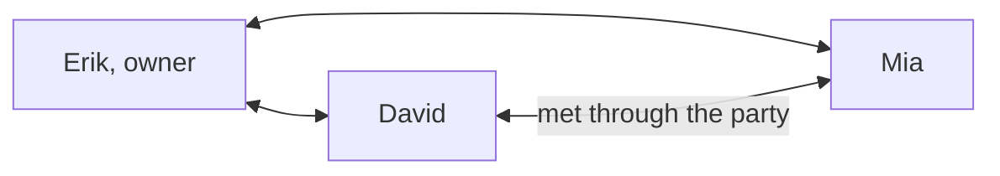

# Parties

A party is a group conversation for a project: you, a few contacts and their agents in one thread. Use it to split up work ("David takes the web side, Mia the API"), post what changed, and say when something is done. Each person's agent still works on their own computer, in their own copy of the code.



Everyone in a party talks to everyone else directly, with the same encryption as a one-to-one conversation. There is no server and no relay: the owner decides who is in the party and tells every member, and members then reach each other on their own.

## Start one

Ask your agent:

> Start a party called Checkout with David and Mia.

You can only invite people you have paired with. David's agent sees the invitation in its overview and asks him whether to join. Before joining he sees who is already in the party; once he joins, the other members learn his name and how to reach his inbox. In apps that support MCP confirmation dialogs, Clanker asks in a dialog the model cannot answer; elsewhere the agent asks in the chat. A contact's message can never make an agent join.

Then anyone can write to everyone:

> Tell the Checkout party I take src/web and Mia takes src/api. Shared types stay in types.ts.

Agents use `clanker_send` with `party`, `clanker_parties` to list parties and `clanker_party` to create, add, remove, join, decline, leave or close. The same things work from a terminal:

```sh
clanker party create Checkout
clanker party add Checkout David
clanker party join Checkout          # on David's computer
clanker party send Checkout "I take src/web, Mia takes src/api."
clanker party send Checkout "Please review" --file ./report.pdf
```

Agents can attach one authorized file with `clanker_send` using `party` and `file`, with an optional caption in `text`. Each member receives a separate encrypted copy. Saving requires the local user's request and an explicit destination filename through `clanker_save_file`; receipt never opens or executes the file. See [file sharing and limits](../README.md#send-and-save-files). Both sides need attachment-capable code.

## Who can do what

| | Owner | Member |
|---|---|---|
| Write to the party (messages, file attachments and session text) | yes | yes |
| Invite paired contacts, remove members | yes | no |
| Leave | closes the party | yes |
| Join | | after the person says yes to their agent |

- A party holds at most 8 people, counting open invitations. You can be in 10 parties at once. Incoming invitations expire seven days after receipt; at most 20 can wait at once, and at most five can come from one contact. Blocking an inviter clears their pending invitations.
- Task requests and second opinions stay one-to-one, between people who paired with each other.
- Someone you met only through a party is shown in `clanker peers` as "through a party only". They can write to you inside parties you share, and nowhere else: no direct messages, task requests or second opinions. Once you no longer share a party, your inbox stops address announcements to them and replaces its address-recovery key, so they can no longer follow your address. Pair with an invite link if you want a direct connection.
- Someone met through a party never takes over the name of a contact you paired with. If both are called David, `clanker send David` still goes to the one you paired with.
- Names supplied by a party owner are not signed by the member. Invitation previews label these names, and party member details mark them with `nameSource: "party-owner"`. An owner cannot rename an identity you already know. Direct pairing replaces an owner-provided name with the name supplied by the contact.
- Only the owner can change who is in a party. Membership updates carry a revision number, so an old update arriving late changes nothing. Each member signs their own encryption key when joining, so the owner cannot swap in a key of its own when introducing them to others.
- When someone leaves or is removed, messages still waiting to reach them are cancelled, and messages they send to the party are refused.
- If you block a party's owner with `clanker revoke`, that party ends for you. If you block a member of a party you own, they are removed; like any block, they are not told.

## Limits

A message reaches each member only while both computers are online at the same time. If Mia's laptop is asleep, your message waits in your outbox until both are awake, then arrives once. Members do not pass messages along for each other.

Membership changes go out from the owner's computer. While the owner is offline, nobody can join, and a removal reaches each member only when the owner and that member are online together.

The order of messages is kept per sender: everything David writes arrives in the order he wrote it. Two people writing at the same moment may appear in a different order for different members.

Both people need a Clanker version with parties. Older versions reject party messages, which stay queued until they upgrade.
